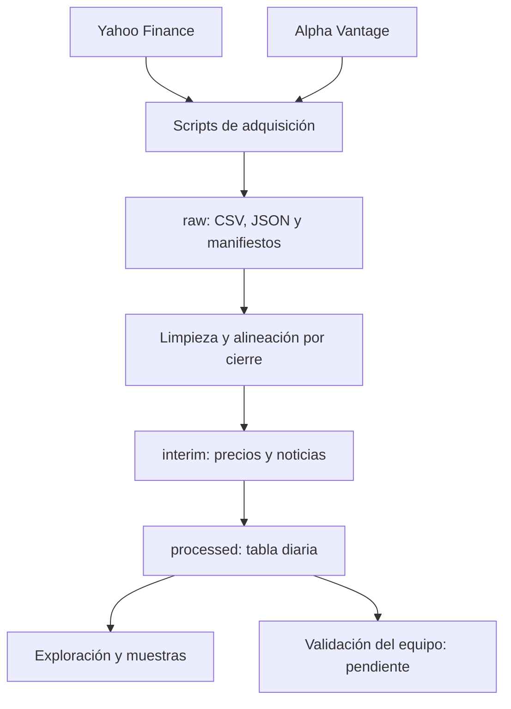

# Arquitectura implementada en código

## Almacenamiento
Local: data/raw, data/interim y data/processed. Databricks: misma jerarquía dentro de una subcarpeta de un Unity Catalog Volume configurado mediante --data-root. GitHub almacena solo código, documentación y muestras autorizadas; no el histórico ni las claves.

## Herramientas y transformaciones
Python, requests, yfinance, pandas, NumPy, PyArrow, pandas_market_calendars y Matplotlib. Limpieza de tipos, identificación de duplicados, calendario real, retorno logarítmico, unión de fuentes, creación de variables y Parquet por ticker/año.

## Reanudación y trazabilidad
Snapshots con checksum, metadatos y log de adquisición. Manifiesto final solo después de cubrir todas las ventanas; los errores no sustituyen noticias por cero. El processing exige configuración coincidente y archivos íntegros. No modifica las tablas/Volumes GDELT existentes.

## Escalabilidad
Este piloto usa pandas por su tamaño. La primera restricción al ampliar será cuota/cobertura de noticias; después, el procesamiento de JSON y su agrupación en memoria. Para varias acciones y años se puede migrar lectura, limpieza y unión a PySpark/Delta; antes hay que medir. No se ha implementado ni medido esa migración. Una partición anual por ticker reduce exceso de archivos diminutos; no garantiza mejora.

## Estado
Arquitectura del código entregado. Pendiente confirmar funcionamiento externo en el workspace real y registrar ubicaciones y volumen observados. El compañero 2 actualizará este documento con evidencia de ejecución.
